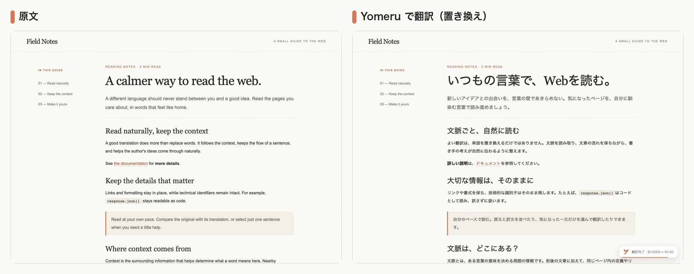
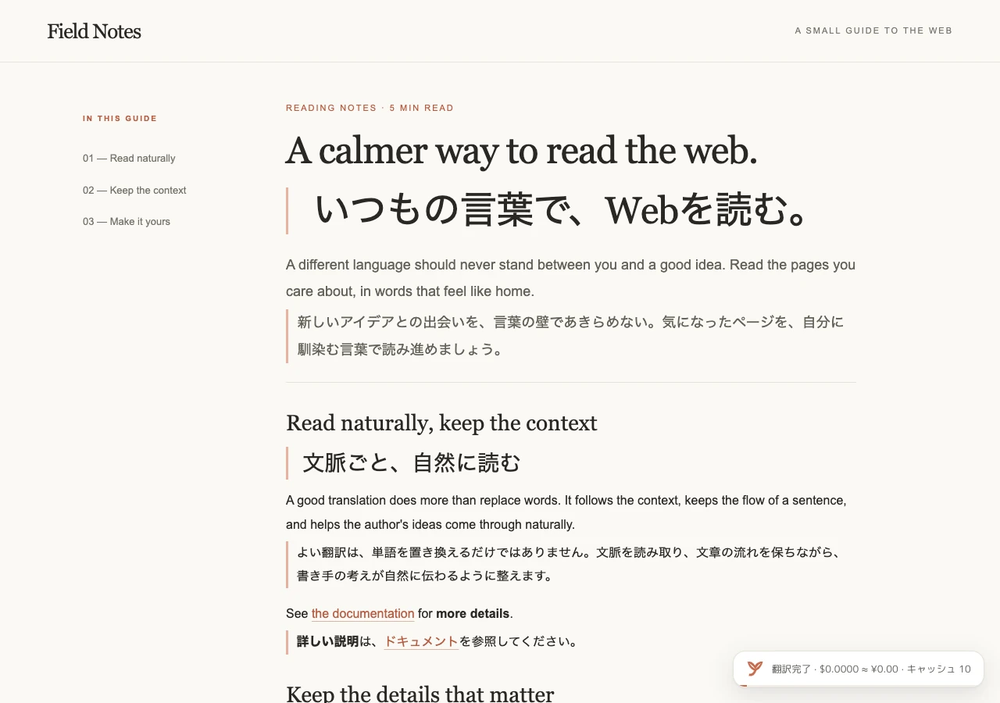
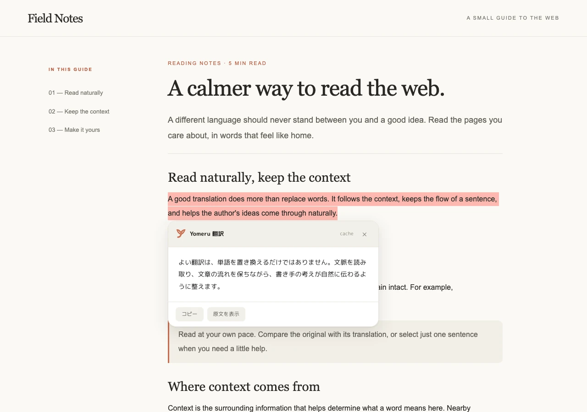
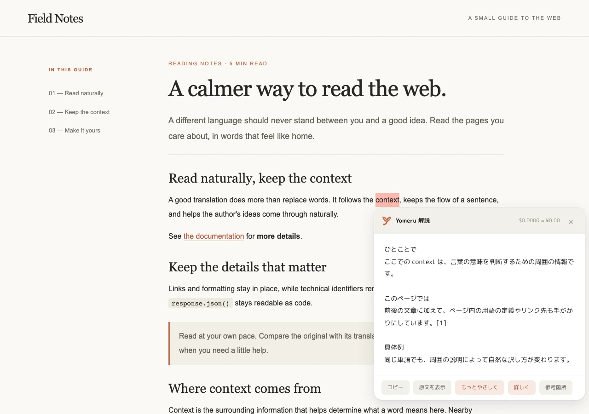
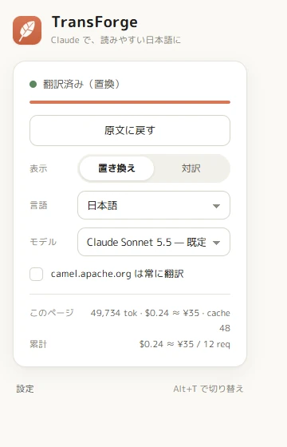
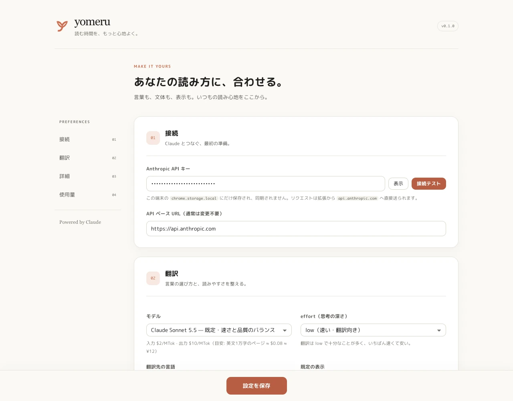

# Yomeru（よめる）

<p align="center"></p>

**気になるページを、いつもの言葉で。**

Claude API で Web ページを自然な日本語に翻訳する Chrome 拡張（Manifest V3・ビルド不要）。
ページ全体を読みやすく置き換える、原文と訳文を並べる、気になった一文だけを訳す・解説する。読み方に合わせて選べます。

名前は「読める」から。ロゴは、小文字の **y** に開いた本のページとしおりを重ねた、背景のないマークです。



<sub>サンプル文書と用意した訳文を使い、実際の拡張機能で撮影したデモ画面です。</sub>

## セットアップ

```sh
git clone https://github.com/HiyokoSauna37/yomeru.git
```

1. Chrome で `chrome://extensions` を開き、右上の **デベロッパーモード** を ON
2. **パッケージ化されていない拡張機能を読み込む** → このフォルダ（`yomeru/`）を選ぶ
3. ツールバーの Yomeru アイコン → **設定**（または拡張の「詳細」→「拡張機能のオプション」）
4. **Anthropic API キー**を貼って **接続テスト** → **設定を保存**

API キーはこの PC の `chrome.storage.local` にだけ保存され、リクエストは拡張のサービスワーカーから `api.anthropic.com` に直接送られる（中継サーバーなし）。

## 使い方

| 操作 | 方法 |
|---|---|
| ページ全体を翻訳 / 原文に戻す | ツールバーの Yomeru アイコン →「このページを翻訳」、または **Alt+T**（`chrome://extensions/shortcuts` で変更可） |
| 表示モード | ポップアップの **置き換え**（原文を訳文に差し替え）/ **対訳**（原文の下に罫線付きで訳文） |
| 選択範囲だけ訳す | テキストを選択 → 横に出る **翻訳** ボタン、または右クリック →「選択範囲を Claude で翻訳」 |
| 選択範囲を解説 | テキストを選択 → **解説** ボタン、または右クリック →「選択範囲を Yomeru で解説」 |
| 常に翻訳するサイト | ポップアップの「このサイトは常に翻訳」 |
| 途中で止める | 右下のバッジの **中止** |

翻訳は**画面に見えている部分から**始まり、残りは上から順に流れる。SPA で後から追加された文や、開いた `<details>` の中身も自動で追い翻訳する。

### 画面

**対訳モード** — 原文を残し、段落の下に訳文を差し込む。訳文には左に罫線が付く。



**選択範囲の翻訳** — 文を選ぶと横に「翻訳」ボタンが出る。押すとその場にパネルで訳文（費用つき）。



**選択範囲の解説** — 選んだ語や文の前後に加え、同じページの関連する定義・説明・リンク先の節を集めて解説する。回答中の `[1]` などはパネルの「参考箇所」で確認できる。「もっとやさしく」「詳しく」で同じ文脈を使って説明を変えられる。



**ポップアップと設定** — ポップアップで表示モード・言語・モデルを切り替え、このページと累計の費用を確認。設定ページで API キー、追加指示、用語集、キャッシュ、常に翻訳するサイトなどを管理。

<table>
<tr>
<td width="30%" valign="top"></td>
<td width="70%" valign="top"></td>
</tr>
</table>

## 語順の扱い（重要）

Google 翻訳は HTML のテキストノード単位で訳すため、`<a>` や `<strong>` で分かれた語句の順序が日本語で崩れる。
Yomeru は **段落（run）全体を 1 セグメント**として渡し、リンク・太字などは `<i0>…</i0>`、コード・画像などは `<i1/>` というマーカーに置き換える。Claude には「日本語の語順に合わせてマーカーごと並べ替えてよい」と指示し、返ってきた順序どおりに DOM を組み直す。

```
原文: See <i0>the documentation</i0> for <i1>details</i1>.
訳文: <i1>詳細</i1>は<i0>ドキュメント</i0>を参照してください。
```

- 構造が変わらなければ元のテキストノードの中身だけを書き換える（React 等のアプリを壊しにくい）
- 順序が変わった場合は要素を複製して並べ替える（`href` などの属性は維持）
- マーカーが壊れて返ってきたときは 1 回だけ単体で再試行し、それでも駄目なら訳文テキストを置いて黄色の点線下線で印を付ける

`<code>` / `<pre>` / 個別要素の `translate="no"` / `.notranslate` / 非表示要素 / `nav`・`aside`（設定で変更可）は訳さない。
`html`・`body` のページ全体の翻訳禁止指定があっても、ユーザー操作で翻訳できる。
型名（String, boolean…）・識別子・オプション名・true/false は原語のまま残すようプロンプトで指示している。

## モデルと費用

| モデル | 入力 / 出力 ($/MTok) | 英文 1 万字のページの目安 |
|---|---|---|
| Claude Opus 5.5 | 4 / 20 | ≈ $0.16 ≈ ¥24 |
| Claude Sonnet 5.5（既定） | 2 / 10 | ≈ $0.08 ≈ ¥12 |
| Claude Haiku 5.5 | 0.10 / 0.50 | ≈ $0.004 ≈ ¥0.6 |

- ポップアップに **このページ** と **累計** の概算コストを表示する
- 同じ文は **翻訳キャッシュ**（IndexedDB）から返し、再課金しない（置換⇄対訳の切替や再訪問は無料）
- 解説も選択内容・周辺文脈・説明の詳しさごとにキャッシュする。ページ内の情報が変われば別の結果として扱う
- `effort` は `low` が既定（翻訳には十分で最速）。設定で変更可
- Opus / Sonnet / Fable では安全分類器による拒否時にサーバー側フォールバック（`fallbacks: "default"`）を有効にしている

## 設定項目

- 翻訳先の言語（既定: 日本語）、既定の表示モード
- **追加指示**（文体・分野）と **用語集**（`原語 = 訳語` を 1 行 1 つ）はシステムプロンプトに入る
- 選択範囲の **解説ボタン** と右クリックメニューの表示切り替え（既定: ON）
- 1 リクエストの文字数上限 / 同時リクエスト数（レート制限に当たるなら下げる）
- nav / aside を訳さない、キャッシュの ON/OFF と削除、常に翻訳するホスト一覧、表示用の USD/JPY レート
- 使用量（リクエスト数・トークン・概算コスト）とリセット

## 構成

```
manifest.json          MV3
background.js          service worker: API 呼び出し・再試行・キャッシュ・使用量・注入
content/segmenter.js   DOM → セグメント化（マーカー直列化 / 復元 / in-place 適用）。純粋な DOM ロジック
content/context.js     選択箇所の周辺と、ページ内の関連する定義・用例を収集
content/ui.js          ページ内 UI（進行バッジ・選択翻訳ボタン・翻訳パネル）の shadow DOM。表示だけを担当
content/content.js     翻訳の進行・適用・復元、MutationObserver による追い翻訳、選択翻訳、メッセージ処理
content/content.css    対訳モードの訳文スタイルと UI 用フォントの @font-face
popup/, options/       ポップアップと設定ページ（shared/theme.css の Claude 風暖色テーマ、shared/ui.js の共通ヘルパー）
fonts/                 UI 用の丸ゴシック M PLUS Rounded 1c（OFL、woff2 サブセット・ページ本文には使わない）
shared/                models.js(モデル表・価格・既定値) api.js(リクエスト) prompt.js(翻訳) explain.js(解説) cache.js settings.js ui.js
icons/                 背景のない y マーク（SVG / PNG、16〜128px）
tools/                 make_icons.py(アイコン) check.mjs(構文チェック) capture_demo.mjs + make_readme_assets.py(README 画像)
docs/                  hero.webp と shots/*.webp（README 用画像）
tests/                 harness.mjs(拡張入り Chromium の起動) e2e.mjs(翻訳 E2E) explanation.mjs(解説 E2E) real_api_check.mjs diag_as2.mjs
```

## テスト

```
npm run check                        # 構文チェック
npm i && npx playwright install chromium   # E2E の準備（playwright-core + Chromium。headless shell では拡張を読めない）
npm test                             # モック API に対する E2E（翻訳 / 復元 / 対訳 / 選択翻訳 / 解説 / 設定移行）
ANTHROPIC_API_KEY=... npm run real [-- model]   # 実 API で Camel AS2 の実セグメントを翻訳（課金あり・数セント）
```

README の操作画面は、サンプル文書と用意した訳文を使って実際の拡張機能から撮影する。外部 API や API キーは不要。

```sh
node tools/capture_demo.mjs
python tools/make_readme_assets.py
```

実ページ・実 API の撮影には `ANTHROPIC_API_KEY=... node tools/capture_readme.mjs` を使用できる（API 料金が発生）。
メイン画像は組み込み imagegen で作成し、生成条件は [docs/hero.prompt.json](docs/hero.prompt.json) に記録している。

`tests/fixture/as2.html` は検証用に保存した [Apache Camel の AS2 コンポーネント文書](https://camel.apache.org/components/4.22.x/as2-component.html)（Apache License 2.0）のスナップショットです。

## 既知の制限

- iframe の中身（別フレーム）は訳さない
- 画像の `alt`、`placeholder`、`title` 属性は訳さない
- 解説はページ内の表示テキストを対象とし、関連する箇所を最大 8 件・合計約 1 万文字まで参照する。リンク先の外部ページや iframe の中身は取得しない
- React 等が翻訳後にテキストを書き戻した場合、その段落は再翻訳対象になる（無限ループ防止のため追い翻訳は 60 回まで）
- 閉じた Shadow DOM の中は見えない
