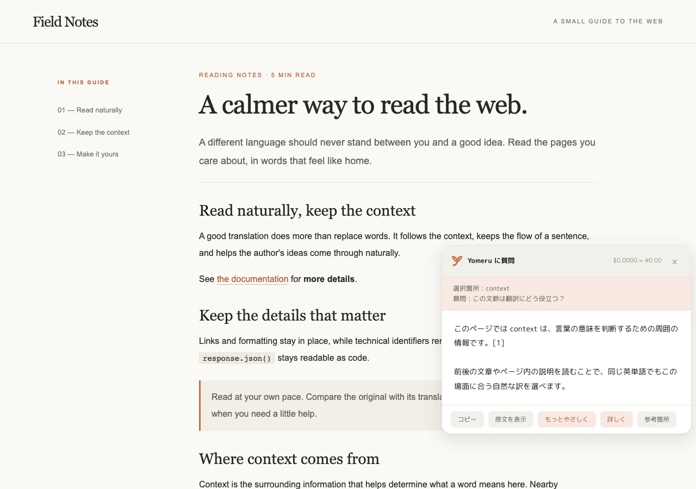

# Yomeru（よめる）

<p align="center"></p>

<p align="center">
  <strong>英語の Web ページを、その場で「読める」に。</strong><br>
  翻訳サイトへコピペせず、ページを離れず、自然な日本語で読み進める。
</p>

<p align="center">
  <a href="#3分で使い始める"><strong>3分で使ってみる</strong></a>
  ·
  <a href="#こんな読み方ができます">できることを見る</a>
  ·
  <a href="#料金の目安">料金を確認する</a>
</p>

Yomeru は、自分の Claude API キーで動く個人用 Chrome 拡張です。
海外の技術資料も長い記事も、翻訳から質問まで今開いているページの中で完結します。

- **ページを丸ごと読む** — レイアウトやリンクを保ちながら、本文を日本語に置き換える
- **原文と読み比べる** — 段落ごとに原文と訳文を並べる対訳モード
- **その場で深掘りする** — 気になる箇所だけを翻訳・解説し、自由に質問できる

> [!NOTE]
> 必要なのはデスクトップ版 Chrome と Claude API キーです。現在は Chrome ウェブストア未公開のため手動インストールですが、ビルドや Node.js は必要ありません。

## 読み慣れたページのまま、日本語で


リンクや太字、コードを保ちながら、本文を文脈に沿った日本語へ置き換えます。

<sub>サンプル文書と用意した訳文を使い、実際の Yomeru で撮影したデモ画面です。</sub>

## 3分で使い始める

Claude API キーをすでにお持ちなら、ビルド不要で数分。ダウンロードしたフォルダを Chrome に読み込むだけです。

### 必要なもの

- デスクトップ版 Google Chrome
- [Claude Console](https://platform.claude.com/) で作成した API キー
- Claude API の利用枠またはクレジット（[料金の目安](#料金の目安)）

### 1. Yomeru をダウンロード

[**Yomeru を ZIP でダウンロード →**](https://github.com/HiyokoSauna37/yomeru/archive/refs/heads/main.zip)

ダウンロードした ZIP を展開します。フォルダは、Chrome に読み込んだあとも削除・移動しない場所に置いてください。

<details>
<summary>Git を使う場合</summary>

```sh
git clone https://github.com/HiyokoSauna37/yomeru.git
```

</details>

### 2. Chrome に読み込む

1. Chrome で `chrome://extensions` を開く
2. 右上の **デベロッパーモード**を ON
3. **パッケージ化されていない拡張機能を読み込む**を押す
4. 展開した `yomeru-main/`（Git の場合は `yomeru/`）フォルダを選ぶ
5. Chrome の拡張機能（パズル）アイコンから、Yomeru のピンを ON

### 3. Claude API キーを設定

1. [Claude Console の API Keys](https://platform.claude.com/settings/keys) で、Yomeru に使うワークスペースを選んだ API キーを作成する
2. Chrome のツールバーで Yomeru アイコンを押し、**設定**を開く（見つからない場合は `chrome://extensions` → Yomeru の **詳細** → **拡張機能のオプション**）
3. API キーを貼り、**接続テスト** → **設定を保存**

ワークスペースを指定していない API キーは、現在の Yomeru では使えません。
接続テストも小さな API リクエストを 1 回送ります。利用枠がない場合は、Claude Console の [Billing](https://platform.claude.com/settings/billing) で確認してください。

### 4. 好きなページで翻訳

翻訳したい Web ページを開き、Yomeru アイコンから **このページを翻訳**。
原文へ戻すときは Yomeru アイコンから **原文に戻す**、またはもう一度 <kbd>Alt</kbd> + <kbd>T</kbd> を押します。

<details>
<summary>Yomeru を更新する方法</summary>

- ZIP で入れた場合: 新しい ZIP を取得し、Chrome に登録したフォルダの中身を置き換える
- Git で入れた場合: Yomeru のフォルダで `git pull` を実行する

更新後は `chrome://extensions` を開き、Yomeru の **再読み込み**ボタンを押してください。

</details>

## こんな読み方ができます

### ページを離れず、丸ごと読む

ツールバーのアイコン、右クリック、または <kbd>Alt</kbd> + <kbd>T</kbd> でページ翻訳を開始。
まず画面に見えている部分から訳すため、長いページでも読み始めを待たされにくい設計です。
SPA で後から追加された文章や、開いた `<details>` の中身も追いかけて翻訳します。

### 原文と見比べながら読む

「対訳」なら原文を消さず、そのすぐ下に訳文を表示します。
技術文書や学習用途など、原文のニュアンスを確認しながら読みたいときに便利です。


### 分からない一文を、その場で深掘りする

テキストを選ぶと、横に **翻訳・解説・質問** ボタンが現れます。
単語だけを切り離さず、前後の文章や同じページ内の関連箇所も踏まえて回答します。
回答中の `[1]` などは「参考箇所」から確認でき、同じ文脈のまま「もっとやさしく」「詳しく」と頼むこともできます。

<table>
<tr>
<td width="50%"></td>
<td width="50%"></td>
</tr>
<tr>
<td align="center"><strong>選んだ箇所だけ翻訳</strong></td>
<td align="center"><strong>ページの文脈ごと質問</strong></td>
</tr>
</table>

<details>
<summary>「解説」の画面も見る</summary>


</details>

### 読み方を、自分向けに整える

モデルや表示方法はポップアップですぐ変更できます。
設定画面では、翻訳先の言語、文体、分野別の追加指示、用語集、自動翻訳するサイトまで調整できます。

<table>
<tr>
<td width="30%" valign="top"></td>
<td width="70%" valign="top"></td>
</tr>
</table>

<details>
<summary>操作早見表</summary>

| やりたいこと | 操作 |
|---|---|
| ページ全体を翻訳 | Yomeru アイコン → **このページを翻訳** / 右クリック / <kbd>Alt</kbd> + <kbd>T</kbd> |
| 原文に戻す | ポップアップの **原文に戻す** / <kbd>Alt</kbd> + <kbd>T</kbd> |
| 選択箇所を深掘り | テキストを選択 → **翻訳** / **解説** / **質問** |
| 毎回自動で翻訳する | ポップアップで **このサイトは常に翻訳**を ON |
| 翻訳を途中で止める | 右下の進行表示から **中止** |

</details>

## Yomeru が読みやすい理由

Web ページの文章は、リンクや太字などの HTML 要素で細かく分かれています。
断片ごとに訳すと、日本語にしたときの語順や装飾の位置が不自然になりがちです。

Yomeru は **段落全体をひとまとまり**として Claude に渡し、リンクや太字も日本語の語順に合わせて並べ直します。
コード、識別子、画像など翻訳すべきでない要素はそのまま残します。

- 構造が同じなら元のテキストだけを書き換え、React などのページを壊しにくくする
- 語順が変わっても、リンク先や要素の属性を保つ
- マーカーが壊れた場合は単体で再試行し、それでも復元できなければ見た目で分かるように表示する
- 型名、識別子、オプション名、`true` / `false` は原語のまま残すよう指示する

<details>
<summary>語順を保つ仕組みを見る</summary>

Yomeru はリンクや太字を `<i0>…</i0>`、コードや画像などを `<i1/>` という一時マーカーに変換します。
Claude は文章だけでなくマーカーごと並べ替え、Yomeru が応答を DOM に戻します。

```text
原文: See <i0>the documentation</i0> for <i1>details</i1>.
訳文: <i1>詳細</i1>は<i0>ドキュメント</i0>を参照してください。
```

`<code>` / `<pre>` / 個別要素の `translate="no"` / `.notranslate` / 非表示要素 / `nav`・`aside`（設定で変更可）は翻訳しません。
`html`・`body` 全体の翻訳禁止指定は、ユーザーが明示的に翻訳した場合に限って妨げない設計です。

</details>

## 料金の目安

既定の **Claude Sonnet 5.5** なら、英文 1 万字のページで **約 $0.08（約 ¥12）**が目安です。
まず安く試したい場合は、設定から **Claude Haiku 5.5** を選べます。

| モデル | 入力 / 出力（$ / MTok） | 英文 1 万字の目安 |
|---|---:|---:|
| Claude Haiku 5.5 | 0.10 / 0.50 | 約 $0.004 / ¥0.6 |
| **Claude Sonnet 5.5（既定）** | 2 / 10 | 約 $0.08 / ¥12 |
| Claude Opus 5.5 | 4 / 20 | 約 $0.16 / ¥24 |
| Claude Fable 5.1 | 10 / 50 | 約 $0.40 / ¥60 |

目安は入力 5,000 token、出力 7,000 token、1 USD = ¥150 で計算しています。
実際の料金はページ、設定、為替、Claude API の価格改定によって変わります。最新の単価は [Claude API の公式料金表](https://platform.claude.com/docs/en/about-claude/pricing) を確認してください。

- ポップアップに **このページ**と**累計**の概算料金を表示
- キャッシュが有効で、モデル・翻訳先・指示・用語集・原文が一致する訳文は端末内から返し、新しい API リクエストを送らない
- 解説と質問も、キャッシュが有効で、選択内容・ページ内の文脈・質問・詳しさが一致すればキャッシュを利用

## プライバシーと権限

Yomeru はページを扱う拡張だからこそ、何を保存し、何を送るかを明示します。

- **API キー** — この Chrome プロファイルのローカル領域（`chrome.storage.local`）に保存し、Chrome Sync では同期しません
- **ページ・選択範囲の翻訳で送るもの** — 翻訳対象のテキスト、ページタイトル、URL
- **解説・質問で送るもの** — 選択箇所、質問、周辺とページ内の関連テキスト、ページタイトル、URL
- **送信先** — 既定では拡張から `api.anthropic.com` へ直接送信。Yomeru 独自の中継・分析サーバーはありません
- **送信するタイミング** — 翻訳・解説・質問を実行したとき。「常に翻訳するサイト」に登録したホストではページを開いたとき
- **キャッシュ** — 翻訳・解説結果をこの Chrome プロファイル内の IndexedDB に保存。設定から削除できます

全サイトへのアクセス権限は、開いている Web ページ上で翻訳 UI と DOM 操作を動かすために使います。
API ベース URL を変更した場合、リクエストは指定した URL に送られます。
機密情報を含む社内ページなどでは、その内容を設定先の API へ送ってよいか確認してから使ってください。

## 主な設定

- 翻訳先の言語と、既定の表示（置き換え / 対訳）
- モデルと `effort`
- 文体・分野などの追加指示
- `原語 = 訳語` 形式の用語集
- 選択範囲の解説・質問ボタンの ON / OFF
- nav / aside の除外、キャッシュ、自動翻訳するホスト
- 1 リクエストの文字数、同時リクエスト数、表示用の USD / JPY レート

## 既知の制限

- `chrome://` ページや Chrome ウェブストアなど、Chrome が拡張機能の実行を許可しないページでは使えません
- iframe の中身（別フレーム）は翻訳しません
- 画像の `alt`、`placeholder`、`title` 属性は翻訳しません
- 解説はページ内の表示テキストを対象とし、関連箇所を最大 8 件・合計約 1 万文字まで参照します。リンク先や iframe は取得しません
- React などが翻訳後に本文を書き戻した場合、その段落は再翻訳の対象になります（追い翻訳は 60 回まで）
- 閉じた Shadow DOM の中身は読み取れません

<details>
<summary><strong>開発者向け情報</strong></summary>

### 構成

```text
manifest.json          MV3
background.js          service worker: API 呼び出し・再試行・キャッシュ・使用量・注入
content/segmenter.js   DOM → セグメント化（マーカー直列化 / 復元 / in-place 適用）。純粋な DOM ロジック
content/page.js        ページ翻訳の DOM 適用・復元と、翻訳済みノードの状態管理
content/context.js     選択箇所と質問の語をもとに、周辺やページ内の関連する定義・用例を収集
content/ui.js          ページ内 UI（進行バッジ・選択操作・結果パネル）の Shadow DOM
content/selection.js   選択範囲の翻訳・解説・質問、スクロール追従、リクエストの中止
content/content.js     ページ翻訳の進行、MutationObserver による追い翻訳、メッセージ処理
content/content.css    対訳モードの訳文スタイルと UI 用フォント
popup/, options/       ポップアップと設定ページ
shared/                モデル・API・プロンプト・解説・キャッシュ・設定・UI の共通モジュール
fonts/                 M PLUS Rounded 1c（OFL、ページ本文には不使用）
icons/                 y マーク（SVG / PNG、16〜128px）
tools/                 構文チェック、アイコン・README 画像の生成
tests/                 Chromium E2E、実 API 確認、テスト用 fixture
```

### テスト

```sh
npm run check
npm install
npx playwright install chromium
npm test
ANTHROPIC_API_KEY=... npm run real -- [model]
```

- `npm test`: モック API に対する翻訳・復元・対訳・選択翻訳・解説・質問・設定移行の E2E
- `npm run real`: Apache Camel AS2 の実セグメントを Claude API で翻訳（API 利用料が発生）

### README 画像

デモ画像は、サンプル文書と用意した訳文を使って実際の拡張機能から撮影します。API キーは不要です。

```sh
node tools/capture_demo.mjs
python tools/make_readme_assets.py
```

実ページ・実 API の撮影には `ANTHROPIC_API_KEY=... node tools/capture_readme.mjs` を使えます。
メイン画像の生成条件は [`docs/hero.prompt.json`](docs/hero.prompt.json) に記録しています。
`tests/fixture/as2.html` は [Apache Camel の AS2 コンポーネント文書](https://camel.apache.org/components/4.22.x/as2-component.html)（Apache License 2.0）の検証用スナップショットです。

</details>

---

**Yomeru** は「読める」から。
小文字の **y** に、開いた本のページとしおりを重ねたマークです。
